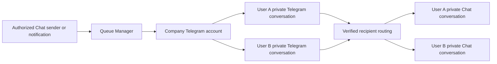

# Company Telegram manager: plan and tasks

Status: planned. This document does not enable company connections or change existing access.

## Goal

Connect one regular Telegram account per company through the Telegram client API (MTProto).
Use that account as the company messaging manager.
Send messages separately to each user's Telegram account.
Route each reply to that user's private Chat conversation.

All Telegram messages appear from the connected company account.
App users do not need their own API credentials or Telegram sessions.
Central management does not give every app user access to the company's Telegram inbox.

## Current implementation

- Chat owns the Telegram backend, frontend, migrations, and synchronization.
- The launcher opens `/app/chat/telegram`.
- Settings opens `/app/chat/telegram/settings`.
- Each connection belongs to one app user and selected company.
- API credentials and sessions are encrypted in the tenant database.
- Explicit dialog links support two-way text synchronization.
- Queue Manager runs `chat.telegram.sync` for sign-in, refresh, disconnect, and synchronization.
- Stable Telegram message identifiers and database transactions protect against duplicate delivery.

Company connections, verified user mappings, and notification fan-out still require implementation.

## Product decisions

| Area              | Planned behavior                                                                                    |
| ----------------- | --------------------------------------------------------------------------------------------------- |
| Connection scope  | One active company connection within its tenant database. No global connection across tenants.      |
| Account type      | Regular Telegram account with API ID, API hash, phone verification, and optional two-step password. |
| Setup             | Authorized company admins manage the connection in Telegram Settings.                               |
| Recipients        | Each active app user has an optional, verified Telegram identity for that company.                  |
| Conversations     | One private Chat conversation per mapped user and company connection.                               |
| Outgoing messages | Authorized company messages and approved notifications reach each recipient separately.             |
| Incoming messages | Replies route by the verified Telegram numeric identity and private dialog.                         |
| Manager access    | Explicitly authorized company managers can access assigned conversations.                           |
| User access       | A user can access only their own conversation and recipient preferences.                            |
| Notifications     | Users opt in to supported categories. Required policies must be explicit.                           |
| First release     | Text messages and selected notification events. No automatic export of old history.                 |

Choose a dedicated company Telegram account.
The account operator can read its Telegram conversations outside CXSUN.
Show this visibility to users before they enable messaging.

## User flows

### Company setup

1. Open Telegram Settings for the selected company.
2. Enter the company account's API credentials and phone number.
3. Complete the Telegram code and optional two-step password.
4. Confirm the displayed Telegram identity and company scope.
5. Grant connection-management and conversation-management permissions to the required roles.
6. Show connection health, queue health, last successful synchronization, and safe errors.

### User enrollment

1. Let an authenticated app user request Telegram enrollment for their company.
2. Show the company Telegram address and a short-lived, single-use verification challenge.
3. Ask the user to send that challenge to the company account from their Telegram account.
4. Match the incoming private message to the pending challenge.
5. Bind the numeric Telegram identity to the app user and company connection.
6. Create the private Chat conversation with explicit participants and manager access.
7. Let the user select supported notifications and enable delivery.

Never verify ownership from a display name, username, or phone number alone.
Do not expose verification messages as ordinary conversation content.
Expire challenges, limit attempts, and prevent replay or duplicate identity assignment.
Unmatched messages must not appear in another user's conversation.

### Messages and notifications

1. Resolve the recipient from authenticated company context and the verified mapping.
2. Check the sender's permissions, conversation membership, recipient status, and notification preferences.
3. Persist one delivery per recipient before enqueueing work.
4. Send through the company session with a stable Telegram random ID.
5. Record queued, sending, sent, retry scheduled, or failed status.
6. Import replies into the mapped Chat conversation without echoing them back.

A multi-recipient notification creates separate deliveries.
One recipient's failure must not block or expose another recipient's message.
Provider acceptance means sent. Do not label it delivered or read without corresponding provider evidence.

## Ownership and security

Keep Telegram business behavior inside the Chat owner.
Platform provides trusted tenant context, access-control integration, queue execution, and composition through public contracts.
Other apps request supported notifications through a fixed public Chat contract.
They must not access Telegram sessions, private repositories, or arbitrary peer identifiers.

The selected tenant database remains the tenant isolation boundary.
Validate company membership for settings, recipient mappings, messages, queue processing, and realtime delivery.
Keep user identifiers stable through the public identity contract.
Do not use mutable email addresses as the sole recipient identity.

Define separate backend permissions for connection management, recipient administration, manager inbox access, and sending.
User self-service also requires authenticated company membership and Chat access.
Recheck access during queued execution and realtime publication.
Record who performed each company action. The original connecting admin is an audit actor, not the shared session owner.

Encrypt credentials and sessions with tenant, company, and connection identity as authenticated encryption context.
Keep secrets out of browser storage, API responses, logs, queue payloads, and this document.
Queue jobs contain opaque identifiers. Workers resolve authorized content from persisted records.

Audit connection changes, enrollment, mapping changes, consent, sends, retries, suspension, and disconnect.
Removing a user or disabling a mapping must stop pending deliveries and realtime access.
Disconnect must clear local secrets and attempt remote session revocation.
Explain manual revocation when Telegram is unavailable.

## Persistence and migration

Add an ordered migration after the latest existing Chat migration.
Do not rewrite previously applied migration steps.
Use integer internal keys, public eight-character UUIDs, explicit foreign keys, timestamps, and status fields.

Plan these owned records:

- Company connection: company, Telegram account identity, encrypted session, authentication state, lease, generation, and health.
- Recipient mapping: connection, company user reference, numeric Telegram identity, private peer, verification, and consent.
- Enrollment challenge: user, connection, hashed challenge, expiry, attempts, and consumed timestamp.
- Private conversation link: recipient mapping and local Chat conversation.
- Delivery: recipient, source message or event, stable random ID, remote message ID, attempts, and safe outcome.

Enforce one active company connection and one active mapping per company user.
Prevent the same Telegram identity from mapping to multiple users within that company connection.
Prevent a private conversation link from sharing another recipient's conversation.

Preserve existing user connections and messages during migration.
Never silently promote a personal connection into a company connection.
Provide an explicit admin adoption flow or a fresh company sign-in.
Adoption requires proof of current ownership and clear company-sharing confirmation.
Re-encrypt adopted secrets for the company scope and retire the old dispatcher atomically.
Keep existing links private until their owners approve migration.
Do not run personal and company dispatchers against the same session concurrently.

Replacing the Telegram account must suspend mappings and invalidate stale jobs until recipients are reverified.
Rollback must pause company sending before restoring the previous mode.
Do not restore retired sessions or widen access as a rollback side effect.

## Ordered implementation tasks

### 1. Finalize contracts and access

- [ ] Confirm the dedicated company account and company scope.
- [ ] Define exact permission keys and role grants in the owning access-control contract.
- [ ] Define user lookup, private conversation membership, enrollment, and notification contracts.
- [ ] Define the first supported notification event and its source owner.
- [ ] Document supported channels, consent, manager visibility, and retention rules.

### 2. Add persistence and safe migration

- [ ] Add the connection, recipient, challenge, conversation-link, and delivery schema changes.
- [ ] Add uniqueness, dependency protection, status transitions, and repeatable permission seeds.
- [ ] Implement explicit adoption without changing existing private access.
- [ ] Re-encrypt adopted sessions and invalidate stale personal jobs in one controlled transition.
- [ ] Test fresh databases, upgrades, migration reruns, and rollback behavior.

### 3. Implement company settings and enrollment

- [ ] Add fixed, validated backend routes and matching frontend contracts.
- [ ] Replace actor-owned authorization with company connection permissions where required.
- [ ] Add company setup, identity confirmation, health, disconnect, and adoption screens.
- [ ] Add authenticated enrollment, challenge verification, preferences, and unlink actions.
- [ ] Add manager recipient administration with duplicate and inactive-user handling.
- [ ] Keep the existing Telegram launcher and use shared UI controls.

### 4. Implement routing and reliable delivery

- [ ] Resolve outgoing targets only through active verified mappings.
- [ ] Create and validate private Chat conversation membership.
- [ ] Route incoming messages by connection and numeric Telegram identity.
- [ ] Persist per-recipient deliveries and expose individual outcomes.
- [ ] Preserve stable random IDs, transactional cursors, and echo suppression.
- [ ] Add renewable connection leases and reject stale connection generations.
- [ ] Honor provider rate limits with scheduled backoff and safe manual retry.
- [ ] Show disabled, stalled, or failed queue execution clearly in Settings.

### 5. Connect notifications

- [ ] Add a fixed public Chat notification operation for approved source modules.
- [ ] Check source authorization, event idempotency, recipient consent, and company policy.
- [ ] Fan out one event into separate recipient deliveries.
- [ ] Keep business notification creation with its source owner.
- [ ] Keep persistent in-app notification storage with its existing owner.
- [ ] Avoid treating a temporary toast as a durable notification record.

### 6. Verify and release

- [ ] Run formatting, focused lint, backend/frontend TypeScript, module boundaries, relevant builds, and dependency checks.
- [ ] Test two users in one company and users in separate companies and tenants.
- [ ] Prove users cannot list, read, send to, or receive realtime events for another user's private conversation.
- [ ] Test challenge expiry, replay, identity conflicts, unauthorized adoption, revoked roles, and removed users.
- [ ] Test restart persistence, worker crashes, lost send responses, lease contention, backoff, and stale jobs.
- [ ] Test account replacement, disconnect, adoption, and migration without duplicate dispatch.
- [ ] Verify Settings and enrollment in the hosted browser and responsive layouts.
- [ ] Confirm desktop and mobile clients enforce the same backend permissions and supported flows.
- [ ] Complete live two-way tests with two consenting recipients and an authorized test message.
- [ ] Record actual results separately from simulated-provider test results.
- [ ] Update the authoritative integration document when the new runtime is implemented.

## Acceptance criteria

An authorized admin connects one company account once.
Two enrolled users receive separate private messages from that account.
Their replies appear only in their respective Chat conversations and authorized manager views.
Neither user can access the company session or another user's messages.
Queued retries do not duplicate messages or cross company boundaries.
Suspension, revocation, account replacement, and disconnect stop unauthorized work.
Existing personal connections remain private until explicit migration.

Files, edits, deletions, group broadcasting, full history imports, and WhatsApp remain outside this first release.
Telegram privacy rules, recipient restrictions, and provider limits still apply.

## References

- [Current integration architecture](../../../assist/architecture/integration-strategy.md#telegram-account-api)
- [Repository agent guide](../../../assist/AGENT-GUIDE.md)
- [Governance rules](../../../assist/governance/rules.md)
- [Telegram API credentials](https://core.telegram.org/api/obtaining_api_id)
- [Telegram authorization](https://core.telegram.org/api/auth)
- [Telegram request errors](https://core.telegram.org/api/errors)
- [Telegram messaging restrictions](https://telegram.org/faq_spam)
